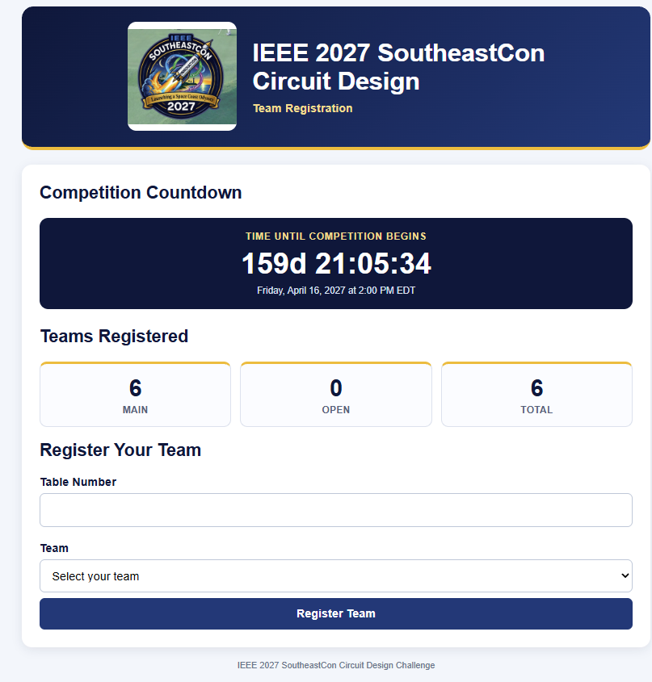

This is the registration portal for the teams as they enter the conference room.

The registered teams are stored in teams.txt in advance so only those teams can register. There is a provision to add new teams if there is a registration error. The registrered teams are stored in teams.db

There is an HTTP GET that returns the list of teams that can be used by the telemetry 
server to validate the teams.

FILES:
- registration_server.py
- images/ the southeastcon image and a snapshot of the registration page

INSTALL / RUN
1. Extract all files into the same empty directory.
2. Use Python 3.10 or later. No third-party packages are required.
3. From that directory run: python registration_server.py
4. Two dynamic websites are created (use server IP address or 127.0.0.1 if local)
   Open http://IP_ADDRtp:8081/register for the main registration page
   Open http://IP_ADDRtp:8081/admin for adding late entries and other admin changes
5. The registration server currently has the starting time of the competition alresdy
   and counting down until the competition starts!
6. Once stopped, summary statistics are printed to the screen and the logfile
7. The currently registered teams can be retrieved via an HTTP GET to /teams
More needs to be put here later.

Note, the teams.txt is a flat file with the format of:
<M or O>, University name [, Team name - optional]

The original version of thd teams.txt file was populated with the team names from 2026 for testing.

